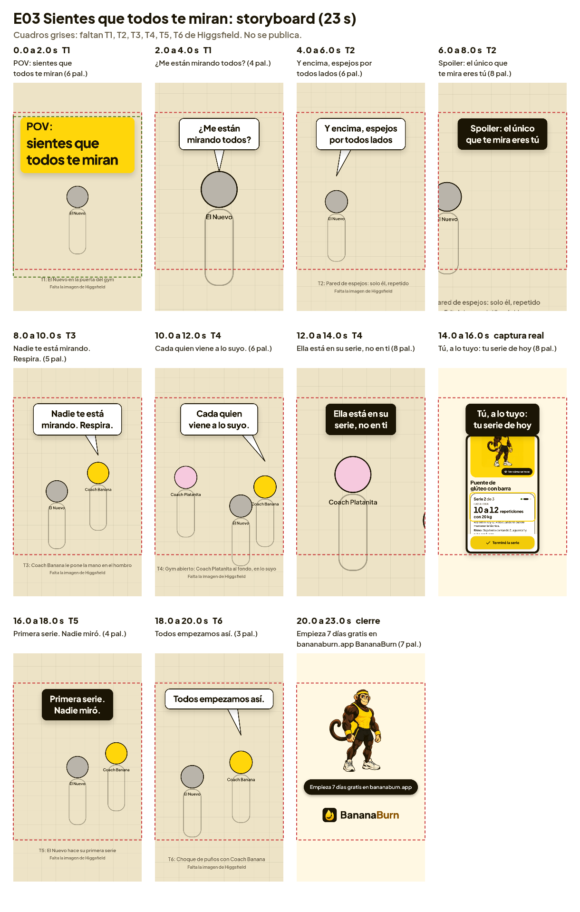

# E03: storyboard

`E03_todos-te-miran_storyboard.png` lo dibuja `proyecto/render.mjs` con los mismos textos, tiempos y cámaras del video: un cuadro por escena, con su tiempo, su toma y su texto con el conteo de palabras. La línea roja es la zona segura (250 px arriba y 350 px abajo) y la verde, en el gancho, es el recorte de la portada a 1080 x 1350.

Mientras faltan las imágenes de Higgsfield, cada toma es un cuadro gris con un círculo donde va la cabeza de cada mono: gris para El Nuevo, banana para Coach Banana y rosado para Coach Platanita. Cuando estén en `proyecto/tomas/`, `npm run storyboard` vuelve a dibujarlo con las imágenes reales.

| # | Tiempo | Toma | Qué pasa |
| --- | --- | --- | --- |
| 1 | 0 a 2 s | T1 | El Nuevo congelado en la puerta. Gancho POV en tarjeta banana |
| 2 | 2 a 4 s | T1 | Golpe de cámara a su cara: "¿Me están mirando todos?" |
| 3 | 4 a 6 s | T2 | Pared de espejos llena de El Nuevo |
| 4 | 6 a 8 s | T2 | Paneo por los reflejos: "Spoiler: el único que te mira eres tú" |
| 5 | 8 a 10 s | T3 | Coach Banana, mano en el hombro: "Nadie te está mirando. Respira." |
| 6 | 10 a 12 s | T4 | Gym abierto: "Cada quien viene a lo suyo." |
| 7 | 12 a 14 s | T4 | Golpe a Coach Platanita en su serie, con audífonos |
| 8 | 14 a 16 s | Captura | La serie del día en la app, captura real |
| 9 | 16 a 18 s | T5 | Primera sentadilla de El Nuevo |
| 10 | 18 a 20 s | T6 | Choque de puños: "Todos empezamos así." |
| 11 | 20 a 23 s | Cierre | Coach Banana señalando, botón y logo |
